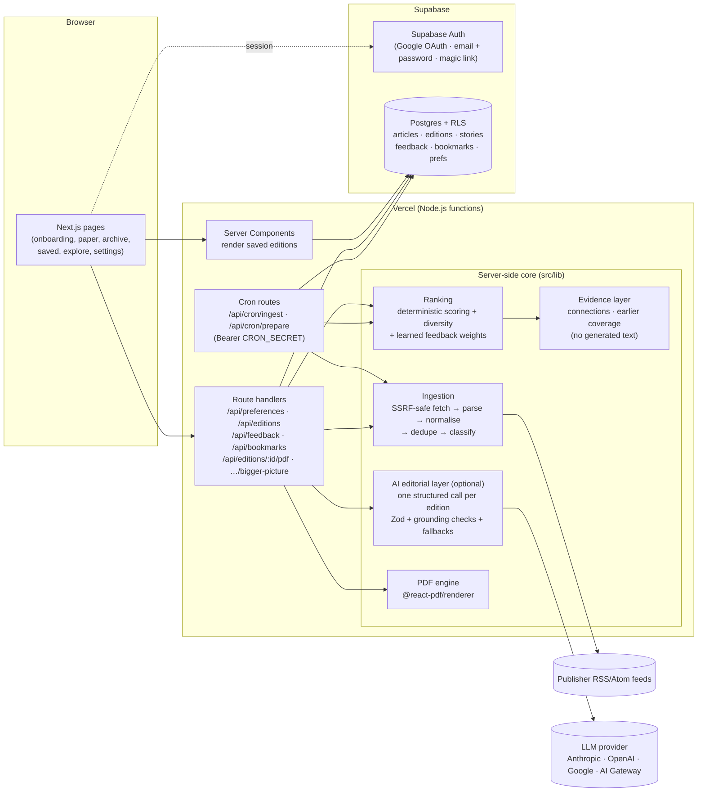

# DAYBREAK

[](https://github.com/tehsaad/DayBreak/actions/workflows/ci.yml)

**The world, filtered through you.** A personal morning paper for the NaSCon'26 AI Hackathon.

DAYBREAK gathers real reporting from 43 RSS feeds (21 publishers, including Dawn, The Express Tribune, Geo, Business Recorder, BBC, The Guardian, NPR, Nature and MIT Technology Review). It ranks the stories around one reader's interests, explains why the important ones matter, learns from that reader's feedback and prints the result as a web newspaper and a matching PDF. Every story links to its original publisher. DAYBREAK stores only headlines and short excerpts.

- **Onboarding:** sections, narrower interests, region with a local/international balance, reading depth and time, and muted topics, publishers or keywords. The reader can step back at any point, and every choice can be edited later in Settings.
- **The paper:** masthead, lead story, front-page sidebar, the reader's sections, "Close to home" stories for their region, and a deliberate "Beyond your usual" slot. Each story carries a short reason for its place ("Matches your interest in scholarships & fellowships").
- **The Bigger Picture:** what happened, why it matters, connections to other stories in today's edition, how the story compares with the reader's earlier editions, what to watch (labelled as interpretation) and a critical-thinking question.
- **Three Things to Remember:** three distinct points, each linked to its supporting stories, with interpretation labelled.
- **Learning:** saves, opens, skips, "more like this" and "not interested" are persisted and decay over time. They re-weight future editions. Every learned weight can be inspected and reset in Settings.
- **PDF:** a typeset, multi-page A4 edition rendered from the same saved edition, with clickable source links and page numbers.
- **Archive:** every edition is kept exactly as published, and can be reopened or re-downloaded.
- **Explore:** search across two weeks of reporting; "One story, many newsrooms" compares headlines across publishers; story threads follow coverage across days; "Outside your bubble" surfaces strong stories from sections the reader doesn't follow.

---

## Contents

1. [Quick start](#quick-start)
2. [Architecture](#architecture)
3. [Configuration](#configuration)
4. [Database setup (Supabase)](#database-setup-supabase)
5. [CI/CD and deploying to Vercel](#cicd-and-deploying-to-vercel)
6. [How it works](#how-it-works)
7. [Security and privacy](#security-and-privacy)
8. [Costs and limits](#costs-and-limits)
9. [Testing and evaluation](#testing-and-evaluation)
10. [Project layout](#project-layout)
11. [Known limitations](#known-limitations)

**Email:** see [`docs/EMAIL_SETUP.md`](docs/EMAIL_SETUP.md) (Resend SMTP for Supabase, templates, welcome email). **Live URL:** https://daybreak-gilt.vercel.app, a free Vercel domain. **Adding API keys:** see [`docs/API_KEYS.md`](docs/API_KEYS.md). Also see [`docs/DEMO_SCRIPT.md`](docs/DEMO_SCRIPT.md) (five-minute Loom script), [`docs/DEPLOYMENT_CHECKLIST.md`](docs/DEPLOYMENT_CHECKLIST.md) and [`docs/EVALUATION.md`](docs/EVALUATION.md) (measured results).

---

## Quick start

Requirements: Node.js 20.9+ (tested on 22) and npm.

```bash
git clone https://github.com/tehsaad/DayBreak.git
cd DayBreak
npm install
cp .env.example .env.local     # optional: add keys (see Configuration)
npm run ingest                 # optional: fetch the feeds now (the app also does this on demand)
npm run dev                    # http://localhost:3000
```

With **no configuration at all**, DAYBREAK runs in:

- **Live news:** the RSS feeds need no API keys.
- **Demo storage:** no account is needed. The reader is identified by an anonymous httpOnly cookie, and data is kept in `.data/daybreak.json` on the server. The UI labels this as **Demo mode** and says it is not synced across devices.
- **No-AI editing:** summaries are the publishers' own descriptions, the editor's note is a template and the Bigger Picture is assembled from evidence. The paper states "No AI text in this edition".

If the feeds can't be reached and nothing is stored, the edition falls back to a clearly labelled **sample** set (see [`docs/SAMPLE_DATA.md`](docs/SAMPLE_DATA.md)). Set `NEWS_MODE=sample` to force that set for offline demos.

Useful scripts:

| Command | What it does |
|---|---|
| `npm run dev` / `npm run build` / `npm start` | Next.js development, production build, production server |
| `npm test` | Vitest unit and integration tests (128 tests) |
| `npm run test:e2e` | Playwright end-to-end reader journey (uses the system Google Chrome; set `PW_CHANNEL=chromium` after `npx playwright install chromium` otherwise) |
| `npm run lint` / `npm run typecheck` | ESLint, TypeScript |
| `npm run ingest [-- --force]` | Fetch every feed into the configured store |
| `npm run eval [-- --refresh]` | Measure personalisation, diversity, feedback effects, PDF consistency and degradation on stored news; writes `docs/EVALUATION.md` |
| `npm run demo:learning [-- --sample]` | Print an edition, apply feedback, regenerate and print the re-ranked edition |

---

## Architecture



**Design decisions**

- **Vercel-native TypeScript:** no separate server. Everything is Next.js 16 App Router on Node.js functions. Pages render saved editions on the server; the browser never talks to an LLM or a feed.
- **Bounded, idempotent work:** on-demand ingestion has an 18–20 s budget, a concurrency of 6 and per-feed timeouts. It skips feeds that are fresh (30 min) or backing off. Edition creation is guarded by a unique key `(user, date, revision)` plus an in-process de-duplication of concurrent requests, so a double click cannot create two editions. Route `maxDuration` is 60 s at most.
- **Saved editions are immutable:** each edition stores a snapshot of every story (title, link, excerpt, publisher, time), plus its summary, reasons, score breakdown and analysis. The archive, the web page and the PDF all read the same record. Opening an old edition never regenerates it. In Postgres, triggers forbid updates except filling in a story's Bigger Picture the first time it is opened.
- **The PDF is rendered on demand** from the saved edition, cached per instance and keyed by `edition id + filled-in analyses`, with an ETag. Nothing is written to the function's temporary disk, so no persistent file storage (such as Vercel Blob) is needed.
- **Storage boundary:** `src/lib/store/types.ts` defines one `Store` interface with two implementations:
  - `SupabaseStore`: Postgres with RLS, using the reader's own session for private data and the service role only for shared news and cron.
  - `FileStore`: demo mode.
- **Provider boundary:** `src/lib/ai/provider.ts` is the only file that knows LLM vendors. It uses the Vercel AI SDK v7, and `LLM_PROVIDER` / `LLM_MODEL` switch provider without code changes.

---

## Configuration

Copy [`.env.example`](.env.example) to `.env.local` locally, or set these variables in the Vercel project. Only `NEXT_PUBLIC_*` values ever reach the browser.

| Variable | Required | Purpose |
|---|---|---|
| `NEXT_PUBLIC_SUPABASE_URL` | for accounts | Supabase project URL. Public by design |
| `NEXT_PUBLIC_SUPABASE_PUBLISHABLE_KEY` | for accounts | Supabase publishable key (`sb_publishable_…`), restricted by RLS and public by design. The legacy `NEXT_PUBLIC_SUPABASE_ANON_KEY` is accepted instead |
| `SUPABASE_SERVICE_ROLE_KEY` | for durable shared news and cron | **Server-only.** Accounts work without it, but then the shared news pool is cached per server instance and scheduled preparation is skipped. Used for shared news data and cron. `SUPABASE_SECRET_KEY` is accepted instead. Never give it a `NEXT_PUBLIC_` prefix: those values are inlined into browser bundles, and the deploy gate refuses any `NEXT_PUBLIC_…SERVICE_ROLE/SECRET/API_KEY/TOKEN` variable |
| `LLM_PROVIDER` | optional | `anthropic`, `openai`, `google`, `gateway` or `none`. Unset: the first provider whose key is present |
| `LLM_MODEL` | optional | Model id. Defaults: `claude-haiku-5-5` (Anthropic), `anthropic/claude-haiku-5.5` (AI Gateway). Set it explicitly for OpenAI or Google |
| `ANTHROPIC_API_KEY` / `OPENAI_API_KEY` / `GOOGLE_GENERATIVE_AI_API_KEY` / `AI_GATEWAY_API_KEY` | optional | Provider key. On Vercel, `LLM_PROVIDER=gateway` needs **no key**: the AI Gateway authenticates with the deployment's OIDC token. Locally, set `LLM_PROVIDER=gateway` and use `vercel env pull` to get `VERCEL_OIDC_TOKEN`. Gemini / Google AI Studio keys work under `GOOGLE_GENERATIVE_AI_API_KEY`, `GEMINI_API_KEY` or `GOOGLE_AI_STUDIO_API_KEY` |
| `GNEWS_API_KEY` | optional | [GNews](https://gnews.io) key. Adds GNews top headlines (Pakistan national and business, world, technology, science, health, sports, entertainment) to the RSS sources. Each category is fetched at most every `GNEWS_FRESH_MINUTES` (default 180), about 64 of the free plan's 100 requests a day. The key is never logged |
| `LLM_TIMEOUT_MS`, `LLM_MAX_OUTPUT_TOKENS` | optional | Defaults 30000 and 4000 |
| `RESEND_API_KEY`, `RESEND_FROM_EMAIL` | optional | Server-only. One-time welcome email after a first Google sign-in (e.g. `DAYBREAK <hello@tehsaad.site>`). Supabase's own auth emails use Resend SMTP configured in the Supabase dashboard |
| `CRON_SECRET` | for cron | Random string. Vercel sends it as `Authorization: Bearer …`. Cron routes refuse to run without it |
| `CRON_USE_AI` | optional | `false` to prepare scheduled editions without LLM calls |
| `NEWS_MODE` | optional | `live` (default) or `sample` |
| `DATA_DIR` | optional | Demo-mode store location (default `.data`, or `/tmp/daybreak` on Vercel) |
| `FEED_FRESH_MINUTES`, `POOL_STALE_MINUTES`, `REGENERATE_COOLDOWN_SECONDS`, `CANDIDATE_HOURS`, `CRON_EDITIONS_PER_RUN` | optional | Tunables. Defaults 30, 90, 45, 48, 20 |

The URL and publishable key turn on accounts. The service-role key additionally moves the shared news pool into Postgres (`src/lib/env.ts`: `supabaseConfig()`, `sharedNewsStorage()`). When Supabase variables are absent, the app runs in demo mode; when LLM variables are absent, it runs without AI. Both states are shown in the UI and at `GET /api/health`, which reports which features are configured but never prints a secret.

---

## Database setup (Supabase)

1. Create a Supabase project.
2. Apply the migrations in [`supabase/migrations/`](supabase/migrations) in order, with `supabase db push` or the SQL editor. They are already applied to the production project `umjwrmnicqflmkoifejj`, with these exact versions and names: tables, functions and triggers, RLS, then foreign-key indexes.
3. In **Authentication → URL configuration**, set the Site URL to your production URL. Add these redirect URLs:
   - `https://<your-domain>/auth/callback`
   - `http://localhost:3000/auth/callback`, for local use
   - `https://*-<your-team>.vercel.app/auth/callback`, if Preview deployments use this project

   Then enable the sign-in providers. The step-by-step guide, including Google Cloud Console, is in [`docs/AUTH_SETUP.md`](docs/AUTH_SETUP.md).
4. Copy the project URL, anon key and service-role key into the environment.
5. Run `npm run ingest` once, or let the first reader's request fetch the feeds.

**Data model**

| Table | Contents | Access |
|---|---|---|
| `sources` | Registry and health of every feed: last fetch and success, status, errors, ETag | read: signed-in · write: service |
| `articles` | Normalised articles: URL, title, excerpt, publisher, times, topics, regions, image; full-text index | read: signed-in · write: service |
| `article_summaries` | AI summaries cached per article and model (not personalised) | read: signed-in · write: service |
| `ingestion_runs` | Per-run results for observability | service only |
| `profiles`, `reader_preferences` | Optional display name; preferences JSON | owner only |
| `editions` | One row per reader, day and revision. Unique `(user_id, edition_date, revision)`. Holds the preference snapshot, ranking metadata, AI usage, sections and Three Things | owner read/insert; updates blocked by trigger |
| `edition_stories` | Ordered stories with article snapshot, summary, reasons, score breakdown, "also reported by" and Bigger Picture | owner; only `bigger_picture` may change |
| `feedback_events` | open, save, unsave, skip, not_interested, rating, follow/unfollow. Unique per `(user, article, type)` | owner only |
| `saved_articles` | Bookmarks with article snapshot | owner only |
| `topic_affinities` | Materialised learned weights, for inspection | owner only |

Editions are created through the `create_edition(edition, stories)` SQL function. It inserts the edition and its stories atomically, does nothing if that `(user, date, revision)` already exists, and runs with the caller's rights, so RLS still applies.

---

## CI/CD and deploying to Vercel

### Continuous integration

[`.github/workflows/ci.yml`](.github/workflows/ci.yml) runs on every push to `main`, every pull request targeting `main`, and on manual dispatch. It runs two parallel jobs:

| Job (check name) | Steps |
|---|---|
| **Typecheck, lint & unit tests** | `npm ci` → `npm run typecheck` → `npm run lint` → `npm test` (JUnit report uploaded as `vitest-report`) |
| **Build & end-to-end** | `npm ci` → install Playwright Chromium (cached) → `npm run build` → `npm run test:e2e` (HTML report uploaded as `playwright-report`; traces as `playwright-traces` on failure) |

- **Credentials:** CI uses none. No Supabase, LLM, cron or Vercel credentials are set, so the app runs in demo storage mode without AI.
  - The unit tests mock the LLM and run the real Supabase migration on in-memory Postgres (PGlite) to check RLS.
  - The end-to-end journey uses the labelled offline sample news (`NEWS_MODE=sample`), so a publisher outage cannot fail CI.
  - The only network access is to npm, the Playwright browser download, and Google Fonts during `next build`.
- **Reproducible installs:** `npm ci` installs exactly what `package-lock.json` specifies.
- **Caching:** npm via `actions/setup-node`, and the Playwright browser keyed by its version.
- **Concurrency:** a newer push cancels a pull request's previous run. Runs on `main` always complete, because production deploys depend on them.
- **Least privilege:** `permissions: contents: read`, and `persist-credentials: false` on checkout.
- **Pinned actions:** third-party actions are pinned to full commit SHAs; Dependabot ([`.github/dependabot.yml`](.github/dependabot.yml)) proposes updates weekly.
- **Failure behaviour:** every step runs a real project command, so any failing command fails the job.
- **Generated route types:** `npm run typecheck` runs `next typegen` before `tsc`. Next.js generates `PageProps`/`RouteContext` types, which a fresh checkout doesn't have until something generates them.

`npm run eval` is **not** part of CI, because its numbers depend on that day's live news. [`.github/workflows/evaluation.yml`](.github/workflows/evaluation.yml) runs it on demand and every Monday. It fetches the public feeds, needs no credentials, posts `docs/EVALUATION.md` to the job summary and uploads it as an artifact.

### Continuous deployment

| What | How |
|---|---|
| **Preview deployments** for pull requests | Vercel's GitHub integration builds every non-`main` branch and comments the preview URL on the PR. |
| **Production** from `main` | Automatic production deploys are switched off in [`vercel.json`](vercel.json) (`"git": { "deploymentEnabled": { "main": false } }`). [`.github/workflows/deploy-production.yml`](.github/workflows/deploy-production.yml) deploys instead, **only after CI succeeds** for that push to `main`. |

The deploy workflow runs these steps in order:

1. Re-check, through the Checks API, that both required CI checks passed for the exact commit. This also applies to a manual dispatch.
2. Verify the Vercel Production environment defines every required variable, and that no secret is exposed as `NEXT_PUBLIC_*`. This uses `vercel env ls` and [`scripts/ci/check-vercel-env.mjs`](scripts/ci/check-vercel-env.mjs), and only ever reads variable *names*.
3. `vercel pull` → `vercel build --prod` → `vercel deploy --prebuilt --prod --skip-domain`. This creates a production **candidate** without moving the domain.
4. Smoke-test the candidate's `/api/health` with [`scripts/ci/check-health.mjs`](scripts/ci/check-health.mjs). It must report `storage: supabase`, `news: live`, a configured AI provider and `CRON_SECRET`.
5. `vercel promote` the candidate. Optionally, the public domain's health is then re-checked.

Steps 1 and the credentials check run in a separate **Preflight** job with no environment. Only when it passes does the **Deploy** job start, open the `production` environment and create a GitHub deployment record. If the Vercel secrets are not configured, Preflight ends with a notice; nothing is deployed and no deployment is recorded. The Vercel secrets are scoped to the individual CLI steps, so `npm ci` and dependency install scripts never see the token. If any later step fails, the production domain keeps serving the previous deployment.

### One-time setup

**Vercel**
1. Import `tehsaad/DayBreak` in the Vercel dashboard. The framework (Next.js) is detected automatically. Because of `vercel.json`, the import does not create a production deployment; the workflow does.
2. **Settings → Environment Variables.** Add the following for **Production**, and for **Preview** too if previews should use real services. Without them, previews run in labelled demo mode.

   | Variable | Value |
   |---|---|
   | `NEXT_PUBLIC_SUPABASE_URL` | Supabase project URL |
   | `NEXT_PUBLIC_SUPABASE_PUBLISHABLE_KEY` | Supabase publishable key (`sb_publishable_…`) |
   | `SUPABASE_SERVICE_ROLE_KEY` | Service-role key. Mark it **Sensitive**, and never use a `NEXT_PUBLIC_` name |
   | `CRON_SECRET` | Long random string, e.g. `openssl rand -hex 32` |
   | `ANTHROPIC_API_KEY` | Or `OPENAI_API_KEY` / `GOOGLE_GENERATIVE_AI_API_KEY` / `AI_GATEWAY_API_KEY`, optionally with `LLM_PROVIDER` and `LLM_MODEL` |

3. **Settings → General:** note the Project ID. **Team Settings:** note the Team (Org) ID. **Account Settings → Tokens:** create a token scoped to the team.
4. *(Optional)* If Deployment Protection covers production deployment URLs, create a **Protection Bypass for Automation** secret for the smoke test. Otherwise the workflow uses `vercel curl`, which authenticates with the token.

**GitHub** (repository → Settings)

1. **Secrets and variables → Actions → Secrets:**
   - `VERCEL_TOKEN`, `VERCEL_ORG_ID`, `VERCEL_PROJECT_ID`
   - optionally `VERCEL_AUTOMATION_BYPASS_SECRET`

   Application secrets live in Vercel, not GitHub.
2. **Secrets and variables → Actions → Variables:** `PRODUCTION_URL` = `https://daybreak-gilt.vercel.app` (already set). The public domain is verified after promotion.
3. **Environments → New environment `production`:** restrict deployment branches to `main`. Optionally add required reviewers for a manual approval before each production deploy.
4. **Branches → Add branch ruleset for `main`:**
   - require a pull request before merging
   - require status checks **Typecheck, lint & unit tests** and **Build & end-to-end**, with branches up to date before merging. GitHub only lists these checks after they have run once, so add them after the first push.
   - block force pushes and deletions

### Manual deployment (fallback)

```bash
npx vercel@62.2.0 link
npx vercel@62.2.0 env ls production | node scripts/ci/check-vercel-env.mjs   # names only
npx vercel@62.2.0 deploy            # preview
npx vercel@62.2.0 deploy --prod     # production (bypasses the CI gate, so use sparingly)
```

See [`docs/DEPLOYMENT_CHECKLIST.md`](docs/DEPLOYMENT_CHECKLIST.md) for the full checklist.

**Cron:** [`vercel.json`](vercel.json) schedules `/api/cron/ingest` at 23:00 UTC and `/api/cron/prepare` at 23:30 UTC (04:00 and 04:30 in Pakistan).

- On the Hobby plan, cron jobs run at most once a day, and the exact minute is not guaranteed.
- Each prepare run handles up to `CRON_EDITIONS_PER_RUN` readers within a 45 s budget. Readers who already have today's edition are skipped, so a re-run is safe.
- Larger audiences need more frequent runs (Pro plan) or a queue. This was not needed for the MVP, so none is included.
- Scheduled preparation only happens after a successful production deployment with `CRON_SECRET` set.
- "Generate my paper" always works on demand, so the product never depends on cron.

**Without Supabase on Vercel:** demo mode stores data in the function instance's `/tmp`, which is neither durable nor shared between instances. Readers may lose their archive. Configure Supabase for any real deployment.

---

## How it works

### Ingestion (`src/lib/news`)

1. **Registry** ([`sources.ts`](src/lib/news/sources.ts)): each feed has a publisher, endpoint, topics, region, priority, and flags for feeds that include full text and for dedicated national feeds. Feeds are only ever fetched from this list.
2. **Fetching** ([`safe-fetch.ts`](src/lib/security/safe-fetch.ts)):
   - DNS is resolved and private, loopback, link-local and CGNAT addresses are rejected on every redirect hop.
   - Requests have an 8 s timeout and a 4 MB cap, and only feed content types are accepted.
   - Conditional `If-None-Match` / `If-Modified-Since` requests are sent.
   - Transient errors get one retry. HTTP 429 is recorded as "rate limited".
   - Repeated failures back off exponentially (15 min up to 12 h).
3. **Parsing** ([`parse.ts`](src/lib/news/parse.ts)): RSS 2.0, Atom and RDF are parsed with `fast-xml-parser`. DOCTYPEs are stripped to prevent entity-expansion attacks.
4. **Normalisation** ([`normalize.ts`](src/lib/news/normalize.ts)):
   - URLs are canonicalised: tracking parameters, fragments and `www` are removed. The article id is a hash of the canonical URL.
   - HTML is stripped and feed boilerplate removed. Excerpts are capped at 480 characters (300 for feeds that include full text).
   - Dates are validated; future dates are rejected.
   - Images must be https and are picked by the largest available width.
   - A deterministic topic and region classifier is applied.
5. **De-duplication:** exact URL duplicates and same-publisher near-duplicates are dropped. Coverage of the same event by different publishers is kept and clustered later, so each event appears once with "Also reported by".
6. **Health:** every run records a per-feed outcome: `ok`, `empty`, `not_modified`, `error`, `rate_limited` or `skipped_*`. Failures are therefore never mistaken for "no news". Settings → Sources shows the health table.

### Ranking (`src/lib/rank`)

Each candidate gets a deterministic score. Every term is 0–1 before weighting, and the weights live in [`score.ts`](src/lib/rank/score.ts):

| Term | Weight | Meaning |
|---|---|---|
| topic | 3.0 | Primary topic followed (1.0) or a secondary topic followed (0.6) |
| interest | 2.0 | Interest keywords in the headline, or at least two in the excerpt |
| region | 1.5 | Local stories weighted by the reader's local/international balance |
| freshness | 1.5 | Exponential decay, half-life 18 h |
| learnedTopic | 2.0 | Learned topic weight from feedback (−1…+1) |
| learnedPublisher | 0.6 | Learned publisher weight |
| quality | 0.5 | Signals the source provides: excerpt, image, author, timestamp |
| coverage | 1.0 | Number of publishers carrying the same story |
| rejectedSimilarity | −3.0 | Similarity to stories marked "not interested" |
| exposure | −2.5 | Already shown on an earlier day |
| mutedSecondary | −1.5 | A secondary topic is muted |

Muted topics, excluded publishers, muted keywords and rejected stories are removed outright. Selection then proceeds in four steps:

1. Seed one story per followed section.
2. Reserve one or two **Beyond your usual** slots for strong stories outside the reader's sections.
3. Fill the remaining slots with diversity penalties for repeated topics and publishers. Any publisher is capped at about 30%, relaxed only when the pool has too few publishers.
4. Choose the lead (bonus for an image and multi-publisher coverage), then assign tiers and sections.

Edition size follows depth and reading time. Reasons are generated only from terms that actually contributed, and at most two are shown.

### Learning from feedback ([`learning.ts`](src/lib/rank/learning.ts))

| Signal | Weight |
|---|---|
| open | +0.3 |
| save | +1.5 |
| unsave | −0.75 |
| skip | −0.4 |
| not interested | −2.0 |
| rating | (value − 3) × 0.75 |
| follow / unfollow | ±1.0 |

- The primary topic receives the full weight and secondary topics half.
- Contributions decay with a 21-day half-life and are capped at ±3 per topic per day. Events older than 90 days are ignored.
- The total is squashed with `tanh(raw / 4)`, so one accidental tap moves a topic by at most about −0.46 and cannot erase a followed section (this is tested).
- Repeated identical actions on one story are de-duplicated.
- "Not interested" also penalises headlines similar to the rejected one for 30 days.

Settings → *What DAYBREAK has learned* shows each topic's weight with up/down counts, offers a reset per topic or for everything, and lists all the weights above. Undo on a hidden story deletes that signal.

### AI editorial layer (`src/lib/ai`)

With a provider configured, DAYBREAK makes **one structured call per edition**. It returns the editor's note, a summary and "why it matters" for each story, the Bigger Picture for the top three stories and Three Things to Remember. Other stories' Bigger Pictures are generated on first open, in one small call each, and then persisted.

- Feed text is treated as **untrusted data**. It is wrapped in `<story>` blocks, any delimiter-like text inside it is stripped, it is length-capped, and the system prompt forbids following instructions it contains.
- Stories are referred to by short ids (S1…Sn). Any id the model invents is discarded, and connections are only allowed between supplied stories.
- Output is validated with Zod and length-capped. A **grounding check** rejects any summary, fact or analysis that states a number not present in its sources. "What changed" is only accepted when real earlier coverage was supplied.
- Each rejected item falls back to source-only content. Timeouts, provider errors and malformed output fall back to a no-AI edition whose note says so.
- Article-level summaries are cached per model in `article_summaries`, so the same article isn't summarised twice. Personalised explanations are kept per edition.
- Without AI, the Bigger Picture is assembled from evidence alone:
  - **What happened** is the publisher's first sentence.
  - **Connections** are stories in the edition that share named entities ("Both stories mention IMF and Pakistan").
  - **Compared with earlier editions** matches headlines and entities in the reader's saved history.
  - **The question** comes from a per-topic template.
  - When the source gives little detail, it says the evidence is insufficient.

### PDF ([`edition-pdf.tsx`](src/lib/pdf/edition-pdf.tsx))

`@react-pdf/renderer` runs on Node.js functions with no headless browser, so the bundle stays small and cold starts are fast.

- **Layout:** masthead and dateline; the lead with its image (fetched through the SSRF-safe client, JPEG/PNG only, 4 s timeout) plus a front-page sidebar; the Bigger Picture; Three Things; then two-column sections. Section headings stay with their first row, and individual stories never split across pages.
- **Furniture:** a running head, "Page X of Y" and an "About this edition" box.
- **Fonts:** embedded Newsreader, Source Serif 4 and Inter (SIL OFL, in `assets/fonts`).
- **Links:** every headline's source is a clickable link.
- **Access:** the route checks that the edition belongs to the requesting reader and returns `Content-Disposition: attachment` with the edition id in a header.

---

## Security and privacy

- **Secrets:** server-only. Provider and service-role keys are read on the server and never imported into client components. `GET /api/health` only reports whether features are configured. No secrets are committed; `.env*` is git-ignored except `.env.example`.
- **Authentication:** Supabase Auth (Google OAuth with PKCE, email and password with confirmation, magic link) through server-side route handlers and `@supabase/ssr` httpOnly cookies, refreshed by `src/proxy.ts`. No tokens are kept in browser storage, and identity is always verified server-side with `getUser()`; a user id sent by the browser is never trusted. The post-login destination is a short-lived httpOnly cookie, validated as a same-site path. Demo mode uses a random UUID in an httpOnly, SameSite=Lax cookie. Setup: [`docs/AUTH_SETUP.md`](docs/AUTH_SETUP.md).
- **Authorisation:**
  - Every private query filters by the reader's id and, in Supabase, runs with the reader's own JWT so **RLS** enforces ownership a second time.
  - Another reader's edition returns 404 (the same response as "doesn't exist").
  - Feedback can only target stories from the reader's own editions. Story metadata is taken from the saved edition, never from the client.
- **Input validation:** every mutation is validated with Zod and capped at 32 KB. Preferences are normalised: unknown regions, interests and time zones are dropped.
- **CSRF:** mutations require a same-origin `Origin`/`Referer` header.
- **SSRF:** feeds come only from the registry. Every fetch hop is DNS-checked against private ranges, size-capped and time-limited. Image URLs must be https. Links are rendered only if they are http(s), so a feed can't inject `javascript:` URLs.
- **Prompt injection:** see the AI section. Model output can never change ranking policy, ids or links.
- **Abuse and cost controls:**
  - Per-reader rate limits on generation, regeneration, Bigger Picture, refresh, PDF and feedback. These are per instance.
  - A durable regeneration cooldown checked against the database.
  - Bounded LLM input and output: one call per edition, cached summaries, `maxOutputTokens`, timeouts and one retry.
- **Cron:** requires `Authorization: Bearer $CRON_SECRET`, compared in constant time. Without a secret the cron routes refuse to run.
- **Headers:** `X-Content-Type-Options`, `Referrer-Policy`, `X-Frame-Options: DENY`, `Permissions-Policy`. `poweredByHeader` is off.
- **Logging:** structured events with no secrets and no article or user text beyond truncated ids.
- **Privacy:**
  - DAYBREAK collects an optional display name, the preferences the reader chooses and their feedback actions. It does no location tracking and has no third-party analytics.
  - The time zone comes from the browser, and only to decide when a new day's edition starts.
  - With AI enabled, article text and the reader's name, region and followed sections are sent to the configured provider. Settings → Your data says so.
- **Copyright:** DAYBREAK keeps only headlines and short excerpts from public feeds, attributes the publisher and links to the original. It does no scraping and does not work around paywalls. Feed images are hotlinked (not stored or proxied) and credited.

---

## Costs and limits

- **News:** the public RSS feeds are free. DAYBREAK identifies itself with a descriptive User-Agent and fetches each feed at most every 30 minutes, using conditional requests.
- **LLM:** about one call per edition. A 12-story balanced edition sends roughly 5–7k input tokens and asks for up to `LLM_MAX_OUTPUT_TOKENS` (4k default). Opening a Bigger Picture costs one small call, only the first time. Check your provider's current pricing; there is no unlimited free inference. `LLM_PROVIDER=none` or `CRON_USE_AI=false` turns LLM use off entirely or for scheduled runs.
- **Vercel:**
  - Functions declare `maxDuration` of 30–60 s.
  - On-demand generation can include up to about 18 s of feed fetching.
  - Hobby-plan cron runs at most daily.
  - Each function instance has its own rate-limit and PDF caches.
- **Supabase free tier:** it is enough for a demo. Articles are the main growth, at roughly 1–2k rows a day; prune old articles periodically if needed.

---

## Testing and evaluation

These checks were run for this submission:

| Check | Command | Result |
|---|---|---|
| Unit and integration tests | `npm test` | **145 passed** (18 files) |
| Migration, RLS and immutability on real Postgres (PGlite) | part of `npm test` (`tests/rls.test.ts`) | passed |
| End-to-end | `npm run test:e2e` | **13 passed**: landing CTAs and reduced motion, search recommendations, debounce and recent searches, broken-image fallbacks, plus the reader journey (with Explore follow and Search), cross-reader isolation, mobile, and 6 Supabase-mode auth tests against an unreachable Supabase. Run with bundled Chromium and `NEWS_MODE=sample` (the CI configuration) |
| Live RLS isolation on the production database | Supabase MCP `execute_sql`, rolled back | Bob saw 0 of Alice's editions, stories, preferences, feedback and bookmarks; cross-user writes blocked; published stories immutable; anonymous users saw nothing |
| Workflow syntax | `actionlint` 1.7.12 with shellcheck 0.11.0 | no findings |
| Types | `npm run typecheck` | clean |
| Lint | `npm run lint` | clean |
| Production build | `npm run build` | succeeds (26 routes) |
| Live ingestion | `npm run ingest` | 43/43 feeds OK, 1,397 articles on first run |
| Evaluation on live news | `npm run eval` | see [`docs/EVALUATION.md`](docs/EVALUATION.md) |

**What the tests cover:**

| File | Area |
|---|---|
| `parse.test.ts` | RSS, Atom, CDATA, encoded HTML, entity-expansion defence |
| `normalize.test.ts` | URL canonicalisation, unsafe URLs, excerpt caps, dates, boilerplate, de-duplication |
| `safe-fetch.test.ts` | SSRF: private ranges, DNS rebinding, redirect hops, size and content-type caps, safe links |
| `scoring.test.ts` | Relevance, determinism, honest reasons, freshness, region balance, exposure |
| `plan.test.ts` | Reproducibility, sizing, tiers, publisher cap, topic diversity, broaden slots, exclusions, clustering, and differences between the three reference readers |
| `learning.test.ts` | Weights, decay, burst caps, secondary share, negative and positive feedback changing the next edition, one accident not erasing a topic |
| `edition.test.ts` | Idempotent ensure, concurrent requests, regeneration cooldown and revisions, immutability, privacy between readers, feedback loop, de-duplicated events, Bigger Picture on demand |
| `ai.test.ts` | Mock-LLM editorial, invented ids and numbers rejected, per-item fallback, provider failure, malformed output, injection sanitising, provider selection, missing keys |
| `api.test.ts` | Validation, CSRF, 401/404/409/429 responses, feedback ownership, undo, bookmarks, PDF headers, links and ETag, cron auth (503/401/200), health without secrets |
| `auth.test.ts` | Google OAuth start (PKCE redirect, safe `next`), password sign-in and sign-up (validation, confirmation, error mapping, CSRF), magic link, callback (code, email token, cancelled, expired), first-login routing, sign-out |
| `routing.test.ts` | Redirect safety, private paths, onboarding-based routing, `proxy.ts` protection in Supabase and demo modes |
| `explore.test.ts` | Onboarding drafts, trusted-publisher boost, feedback and saves on stored articles, follow and unfollow topics, search by words, publisher, date and order |
| `ci-scripts.test.ts` | Deploy gate: missing Supabase, cron or LLM variables, secrets exposed as `NEXT_PUBLIC_`, alias names, health smoke-test outcomes |
| `rls.test.ts` | The real migration under `authenticated` and `anon` roles: isolation, cross-user writes blocked, immutability triggers, `create_edition` idempotency, feedback de-duplication, shared-table permissions |
| `e2e/reader-journey.spec.ts` | Onboarding (including back-navigation), first live edition, Bigger Picture, save, not interested, search, regenerate (the rejected lead disappears), PDF, archive, saved, settings, explore, no console errors, cross-reader isolation, mobile layout |

The three reference readers (`tests/fixtures/profiles.ts`) are an AI and technology researcher, a Pakistan-focused student interested in education and economics, and a climate and science reader in the UK.

**Not run:** tests against a hosted Supabase project and a live LLM provider, because no credentials were available in the build environment. Both paths are covered by the Postgres/RLS tests and the mock-model tests.

---

## Project layout

```
src/
  app/                      pages and route handlers (App Router)
    api/…                   preferences, editions, pdf, bigger-picture, feedback, bookmarks,
                            interests, news, cron, health
  components/               paper view, stories, Bigger Picture, onboarding/settings editors
  lib/
    news/                   source registry, ingestion, parsing, normalisation, sample set
    rank/                   scoring, edition planning, learning
    ai/                     provider abstraction, editorial pass, validation
    edition/                generation service, evidence-only analysis, Bigger Picture
    pdf/                    PDF document and renderer
    store/                  Store interface, Supabase and file implementations
    security/               URL safety and SSRF-safe fetch
    auth/, cron/, server/   reader session, cron auth/preparation, page helpers
  proxy.ts                  Supabase session refresh (Next.js 16 proxy)
supabase/migrations/        schema, RLS, triggers, create_edition()
tests/  e2e/  scripts/      Vitest, Playwright, ingest/eval/demo scripts; scripts/ci = deploy gates
.github/                    CI, production deploy and evaluation workflows; Dependabot
assets/fonts/               OFL fonts embedded in the PDF
docs/                       evaluation, demo script, deployment checklist, sample-data note
```

---

## Known limitations

- **Deployed manually, not yet through the CI-gated workflow.** Production at https://daybreak-gilt.vercel.app was deployed with the Vercel CLI from a clean checkout of `main`. The GitHub deploy workflow stays skipped until the `VERCEL_TOKEN`, `VERCEL_ORG_ID` and `VERCEL_PROJECT_ID` secrets are added.
- **Live sign-in not yet exercised end to end.** Google OAuth initiation reaches Google's consent screen in production, but no real Google or email sign-up, confirmation and onboarding has been completed by an automated test (that needs a real account and inbox). See [`docs/AUTH_SETUP.md`](docs/AUTH_SETUP.md).
- **Dawn blocks Vercel's servers.** Dawn's four feeds return HTTP 403 from Vercel data centres (they work from residential connections). DAYBREAK does not work around publisher restrictions, so they are backed off automatically; Pakistan coverage comes from The Express Tribune, Geo News, Business Recorder and, with a key, GNews.
- **AI summaries were not evaluated on live data**, because no API key was available. The grounding check only verifies numbers; it cannot prove every claim is faithful, so the UI always links to the original and labels AI text.
- **The topic and region classifier is keyword-based.** It is transparent and fast but imperfect: wire stories in national feeds, and puns such as "Off Campus", can be misfiled. Topics are not reclassified with the LLM.
- **English-only feeds.** The PDF fonts cover Latin script; other scripts are transliterated or dropped in print.
- **Rate limits and PDF caches are per instance.** Strict global limits would need a shared store such as Upstash Redis.
- **Demo mode is a single-user-per-browser convenience.** It is not durable on serverless hosting.
- **No push notifications or email delivery** of the morning paper. Editions are read on the web or downloaded as PDF.
- **Feeds change.** A feed that disappears shows up as `error` in Settings → Sources and is backed off automatically, but someone needs to update the registry.
