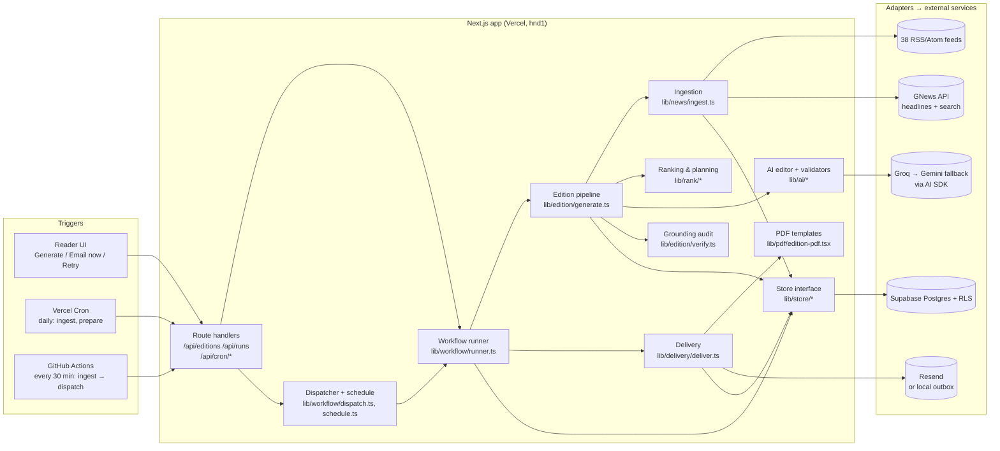
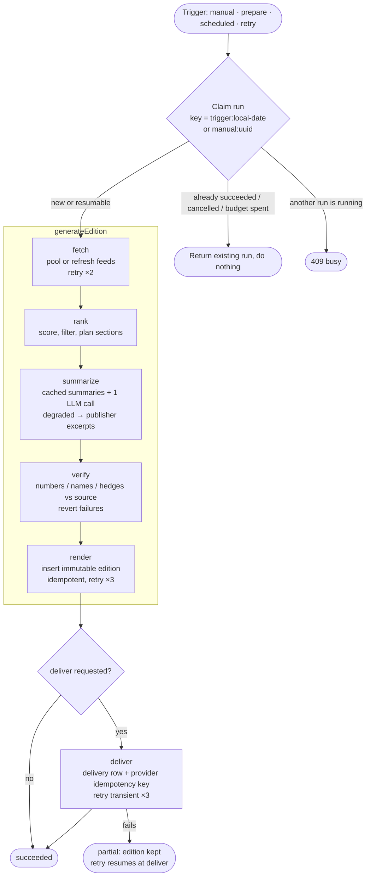
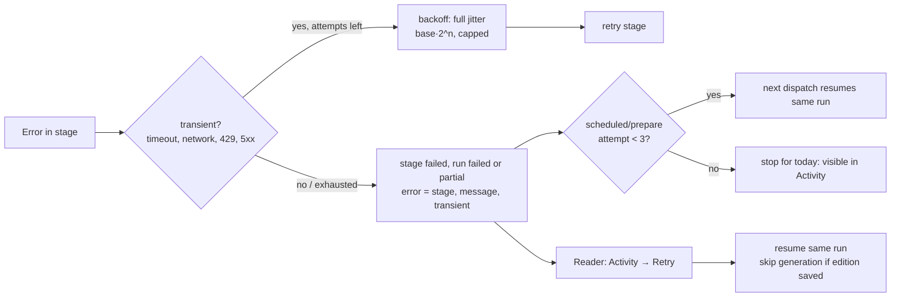
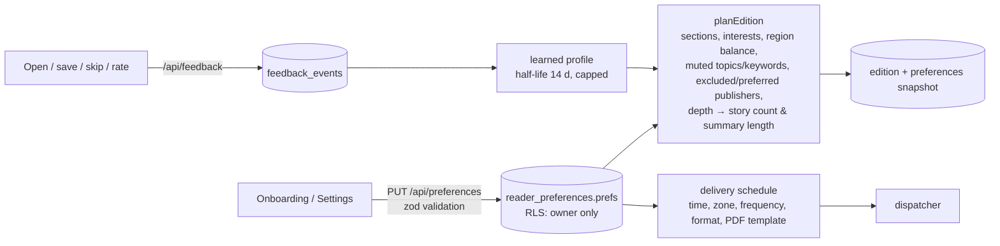

# Target architecture (implemented on `overhaul/orchestration-delivery`)

DAYBREAK is a modular monolith: one Next.js app on Vercel and one Postgres database. Modules have explicit interfaces, and every external service sits behind an adapter. There are no microservices or message brokers. The workload is a few hundred readers, each getting at most a few papers a day, and that does not justify them (ADR-001).

## 1. Components



| Module | Responsibility | Depends on |
|---|---|---|
| `lib/news` | Source registry, fetch (`safeFetch`), parse, normalise, canonical URL, dedupe, GNews headlines and search | `security`, `store` |
| `lib/rank` | Deterministic scoring, section planning, feedback learning | preferences only |
| `lib/ai` | Model creation and fallback, editorial prompt, output validation, summary cache | AI SDK |
| `lib/edition` | `generateEdition` (the stages), evidence-based fallbacks, `verifyStories` | news, rank, ai, store |
| `lib/workflow` | Run and stage model, error classes and retry, stage tracker, runner, schedule maths, dispatcher | edition, delivery, store |
| `lib/delivery` | At-most-once email per edition, link, PDF or both | email, pdf, store |
| `lib/email` | Resend adapter, transport selection (resend, file, log, disabled), templates | — |
| `lib/store` | `Store` interface with Supabase (RLS, reader session) and file (demo) implementations | — |

Interfaces between them:

- The `Store` interface is the only persistence boundary.
- `StageTracker` is how pipeline code reports stages.
- `LanguageModel` is how AI code sees any provider.
- `EmailMessage → SendResult` is how delivery sees any transport.

## 2. The edition workflow



Each stage has a defined input, output, status, error behaviour and log line:

| Stage | Input | Output | Status rules | Retry |
|---|---|---|---|---|
| fetch | stored pool (refreshes feeds if stale) | ≥8 candidate articles, or the labelled sample set | `degraded` if it fell back to sample data | 2 attempts, transient only |
| rank | candidates, prefs, feedback, last 7 editions | planned stories and sections | `failed` (permanent) if nothing matches | none (deterministic) |
| summarize | planned stories, summary cache | AI summaries, intro, analysis | `skipped` with no key; `degraded` if the model fails (excerpts are used instead) | inside the AI SDK plus provider fallback; no extra retries (cost) |
| verify | drafted stories | audited stories plus report | `degraded` when anything was reverted or metadata is missing | none |
| render | edition | stored edition (unique key) | — | 3 attempts (insert is idempotent) |
| deliver | stored edition, email, format | delivery record | `skipped` with no address or transport; `degraded` if the PDF fell back to a link | 3 attempts for 429/5xx/network, none for 4xx |

Every stage start and end is persisted to `workflow_runs.stages`, with timestamps, duration, attempts, metrics, notes and errors. Logs are one JSON line each: `workflow_started`, `stage_done`, `stage_failed`, `stage_retry` and `workflow_finished`. They contain ids and counts only, never content.

**Run states:** `running → succeeded | partial | failed | cancelled`. A `running` row that has not been updated for 10 minutes counts as abandoned. The next claim marks it `failed` and continues.

## 3. Scheduled execution

```mermaid
sequenceDiagram
  participant GH as GitHub Actions (*/30)
  participant API as /api/cron/dispatch
  participant D as dispatch()
  participant W as runEditionWorkflow
  participant DB as Postgres
  participant M as Resend
  GH->>API: GET (Bearer CRON_SECRET)
  API->>D: mode=deliver, budget 240 s
  D->>DB: onboarded readers + prefs
  loop each reader (sequential, until budget)
    D->>D: dueNow(prefs, now)? local time ≥ HH:MM on a delivery day
    D->>W: key = scheduled:<local date>
    W->>DB: find/insert run (unique user+key; one running per user)
    alt already succeeded today
      W-->>D: reused (no work)
    else
      W->>DB: stages… edition (reuses today's if it exists)
      W->>DB: delivery row (pending)
      W->>M: send (Idempotency-Key = edition:<id>:email)
      W->>DB: delivery sent + run succeeded
    end
  end
  API-->>GH: report {due, deliveryRuns, alreadyDone, failed, maxDelaySeconds}
```

- **Schedules are local wall-clock times plus an IANA zone.** UTC conversion happens at run time (`zonedTimeToUtc`), so a DST change shifts the UTC hour, not the reader's time. A time inside a spring-forward gap resolves to the next real instant; a time inside an autumn overlap resolves to its first occurrence. Both cases are tested.
- **"Due" means the time has been reached today and no run has succeeded for today.** It is never "this exact hour", so a late, skipped or duplicated trigger still delivers exactly once that day.
- **Vercel Hobby crons run at most daily.** Sub-daily triggering therefore comes from GitHub Actions. The production scheduler is documented in `docs/operations.md`, which also explains how to check that it really runs.

## 4. Failure handling and recovery



| Failure | Behaviour |
|---|---|
| One feed down | Feed backoff (existing); other feeds continue; stage `succeeded` |
| All feeds down and pool empty | Labelled sample edition; fetch `degraded`; banner in UI, PDF and email |
| LLM error, timeout or 429 | Fallback provider; then publisher excerpts; summarize `degraded` with a note |
| AI summary adds a name or number | `verify` reverts it to the excerpt; counted in `reverted` |
| DB insert transient error | render retried ×3 (idempotent) |
| Email 5xx/429/network | ×3 with backoff; then run `partial`, edition kept |
| Email 4xx (bad address, sender) | No retry; `partial`; message shown in Activity |
| Function killed mid-run | Row stays `running` → stale after 10 min → next claim marks it failed and proceeds |
| Duplicate cron call | Unique `(user, key)` → existing run reused; delivery key prevents a second email |
| Reader cancels | Flag checked between stages; finished work is kept; status `cancelled` |

## 5. Personalisation data flow



Preferences are server-side only. Delivery settings live in the same `prefs` jsonb, so they need no migration. Partial saves (`partial: true`) let the Delivery form update only its own fields. Isolation is enforced twice: the store calls are scoped by user id, and RLS runs on the reader's own session. The RLS tests cover runs and deliveries.

## 6. Data lifecycle and retention

| Data | Lifetime |
|---|---|
| `articles` | Shared pool. The file store prunes after 21 days. Postgres has no automatic pruning yet (roadmap). |
| `editions`, `edition_stories` | Immutable, kept until the account is deleted (cascade). |
| `workflow_runs` | Kept. The file store caps at 200 per reader. For Postgres, see the retention SQL in `docs/operations.md`. |
| `deliveries` | Kept with the run, for audit. They hold no email body, only status, provider id and error text. |
| Outbox (dev) | Local `DATA_DIR/outbox` only. |

## 7. Scaling constraints (honest)

- **Dispatch is sequential**, with a 240-second budget per call and at most 100 readers listed per call. At about 1–3 seconds per reader without AI (5–30 seconds with AI), one call handles roughly 10–100 readers. Readers who are not reached are picked up 30 minutes later. Past roughly 500 readers with the same delivery time, the next step is to fan out with Vercel Queues, one message per reader. The runner is already per-reader and idempotent, so that is a change of trigger, not of design.
- **The edition LLM call is per reader**, with per-article summaries cached and shared across readers. Cost grows with readers × 1 call per day (see `docs/cost-report.md`).
- **GNews free quota is 100 requests a day**, shared by headlines (~64) and reader web search (capped at 25 per instance per day).
